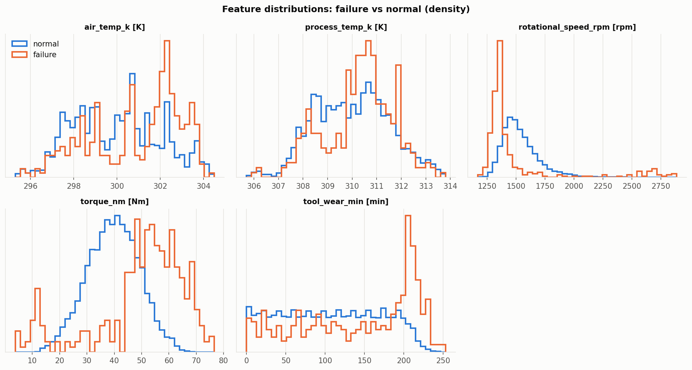

# AI4I 2020 預測性維護：學習筆記


> 本文件由 `ai4i_lab/report.py` 依 `outputs/ai4i/` 的實驗結果自動產生。每個步驟依序說明：目的、做法、結果判讀、踩到的坑。
> 完整論述與研究問題 A／B／C 的回答見 [小論文](ai4i_paper.md)。

## 步驟 1：資料取得與品質檢查

**目的**

取得可追溯的原始資料，並確認它能不能直接用：欄位意義、缺失、重複、數值範圍。

**做法**

從 UCI（id 601）下載後存成 `data/ai4i2020.csv`，記錄來源、SHA-256 前 12 碼 `86a781eb2187`，下載日 2026-10-23，之後所有模組都經 `load_dataset()` 讀取，欄名統一為 snake_case。檢查缺失值、重複列、型別與範圍（例如轉速 1168–2886 rpm、扭矩 3.8–76.6 Nm）。

**結果判讀**

10,000 筆 × 14 欄，缺失 0、重複 0，資料乾淨；但乾淨不代表沒有問題——標記有不一致（步驟 2）。

**踩到的坑**

- 原始 CSV 帶有 BOM，雜湊是對去除 BOM 後的檔案計算的，否則重新下載後雜湊會對不上。
- `Type` 是類別特徵，不能直接當數字；`UDI`、`Product ID` 是識別欄位，放進特徵可能讓模型記住編號（洩漏）。
- 欄名含空格與方括號，建模前先統一改名，避免到處寫字串出錯。


## 步驟 2：探索性分析（EDA）

**目的**

在建模前先看懂資料：不平衡程度、各故障模式、標記是否自洽、有沒有時間結構。這些發現會決定後面的指標與切分方式。

**做法**

統計故障比例與各模式筆數；畫故障 vs. 正常的特徵分布、相關係數熱圖、依 Type 的故障率；找出 `machine_failure` 與五個模式標記互相矛盾的列；依 UDI 排序檢查刀具磨耗是否累積與歸零、空氣溫度是否緩慢漂移。

**結果判讀**

339 筆故障，故障率 3.39%（全猜不故障的準確率就有 96.6%），所以不能只看準確率。Type 影響故障率：L 3.92%、M 2.77%、H 2.09%。標記不一致：9 筆有故障卻無模式、18 筆 RNF=1 卻不算故障。UDI 順序有明顯時間結構：磨耗 98.8% 相鄰列非遞減、119 次換刀歸零、空氣溫度 lag-1 自相關 0.9994。

**踩到的坑**

- 各模式筆數加總（373）大於故障數（339），因為 24 列同時有多種模式；不要把它們當互斥類別。
- 標記不一致不能默默刪掉也不能默默保留：主分析保留原始標記（這是實際紀錄的結果），另做剔除版本當敏感度分析。
- 時間結構是「隱藏的資料洩漏」來源：相鄰列幾乎相同，隨機切分會把近乎重複的列分到訓練與測試。




## 步驟 3：已知規則重建

**目的**

把資料產生規則當成標準答案，後面才能問「模型學到的和規則一樣嗎」。也順便驗證自己對規則和單位的理解正確。

**做法**

依 Matzka（2020）重算 HDF（溫差 < 8.6 K 且轉速 < 1380 rpm）、PWF（功率 = 扭矩 × 轉速 × 2π/60，< 3500 W 或 > 9000 W）、OSF（磨耗 × 扭矩 > 11000/12000/13000，依 L/M/H）、TWF（磨耗 200–240 min 視窗），與資料標記逐列比對，並畫出規則邊界。

**結果判讀**

HDF、PWF、OSF 吻合率 100%（FP = FN = 0）。TWF 只能得到候選視窗：Recall 0.935 但 Precision 只有 0.054，因為 120 個刀具週期中有 116 個到達視窗，只有 46 個在視窗內失效。規則聯集的 Recall 為 0.847，這是純規則偵測的天花板。

**踩到的坑**

- **單位**：轉速要先從 rpm 換成 rad/s 才能算功率；漏了 2π/60，PWF 的規則就會完全失準。
- **浮點誤差**：有 27 列的溫差名義上恰好是 8.6 K，標記是由浮點減法誤差決定的（8.5999…→1、8.6000…→0）。若把溫差四捨五入到一位小數，這些列就無法區分，所以後面的衍生特徵刻意不做四捨五入。
- **TWF 不可能 100% 重建**：失效時點是隨機的，不是任何特徵的函數。看到 Precision 很低不是程式有 bug。


## 步驟 4：特徵工程

**目的**

把物理知識轉成特徵，檢驗「領域知識」對模型的價值（研究問題 B），並嚴格防止洩漏。

**做法**

建立兩組特徵：原始特徵組（5 個數值 + Type one-hot，共 8 欄），以及原始＋衍生特徵組（再加溫差、功率、磨耗×扭矩，共 11 欄）。所有建模一律經 `build_features(df, feature_set)` 取得特徵，函式內斷言特徵不含故障模式、目標與識別欄位。

**結果判讀**

衍生特徵的價值在步驟 7 量化：隨機森林 CV PR-AUC 增加 0.121。

**踩到的坑**

- 特徵清單裡只要混進 `twf/hdf/pwf/osf/rnf` 任何一欄，模型就會「完美」預測，這是最常見也最致命的洩漏；用測試守住。
- Type one-hot 三欄全保留會讓線性模型共線，需搭配正則化。
- 衍生特徵與原欄位高度相關，這在樹模型沒問題，在解釋重要度時要記得「重要度會被分散」。


## 步驟 5：PCA 降維視覺化

**目的**

用最常見的線性降維，看故障樣本在低維空間是否可分，並討論 PCA 的限制。

**做法**

標準化後對兩組特徵各做 PCA，畫前 3 個主成分的 3D 散佈圖（標示故障與各模式），比較解釋變異；再用「只含前 3 個主成分的邏輯斯迴歸」做可分性探針。

**結果判讀**

前 3 個主成分累計解釋變異：原始 69.8%、衍生 64.6%。只用前 3 個主成分的 CV ROC-AUC 為 0.721／0.777，全部特徵為 0.899／0.926。故障沒有形成獨立的群。

**踩到的坑**

- PCA 是非監督的，3.39% 的故障幾乎不影響共變異矩陣，所以「PCA 看不出來」不代表資料不可分，只代表線性、依變異排序的投影看不出來。
- 衍生特徵多了，前 3 個主成分的解釋比例反而可能下降；解釋變異高低 ≠ 故障資訊多寡。
- 單一主成分裡最能分辨故障的是 PC6（原始組），並非變異最大的前幾個；取前 3 個會把它丟掉。


## 步驟 6：評估框架：切分、重複 CV 與信賴區間

**目的**

在故障只有幾十筆的情況下，讓每個數字都附上不確定性，並檢查切分方式會不會讓結論過度樂觀。

**做法**

以 UDI 為鍵做分層 60/20/20 切分並存成 `splits.json`；開發集上做 5 折重複分層 CV，信賴區間採 Nadeau–Bengio 校正；另做依時間順序的切分當穩健性檢驗；並以 KS 檢定量化訓練與測試的分布差異。

**結果判讀**

時間順序切分的故障率從 4.25% 降到 1.95%，air_temp_k 的 KS = 0.479；平均 PR-AUC 從 0.670（分層）降到 0.508（時間，測試段）。

**踩到的坑**

- 重複 CV 的各折共用訓練資料，**不獨立**；直接用標準差算 t 區間會過窄，要用校正的方法。
- 測試集只能看一次。穩健性檢驗的切分也要先剔除共用測試集的列，否則等於偷看。
- 單次切分的測試集只有 67 筆故障，差一筆就會讓 Recall 差 1.5%。


## 步驟 7：二元分類：模型、不平衡處理與 MLP 調參

**目的**

比較邏輯斯迴歸、隨機森林、HistGradientBoosting 與 MLP，在兩組特徵與三種不平衡處理下的表現，並選門檻。

**做法**

每個 模型×特徵組×不平衡處理 做重複分層 CV（過採樣放在 Pipeline 內，只動訓練折）；MLP 在驗證集上搜尋隱藏層、學習率、L2；最終模型只在訓練集訓練，驗證集選使 F1 最大的門檻，測試集只評估一次。

**結果判讀**

最佳為隨機森林＋原始＋衍生特徵：CV PR-AUC 0.900，測試 PR-AUC 0.901 [0.835, 0.954]。MLP 測試 PR-AUC 只有 0.636（原始）／0.648（衍生）。6／8 個組合的最佳不平衡處理是「不處理」。

**踩到的坑**

- SMOTE 如果在切分前做，合成樣本會滲進驗證折，分數會虛高；一定要放在訓練折內。
- 類別權重／SMOTE 會把 Recall 拉高、Precision 壓低；是否划算要看成本（步驟 11），不是看 F1。
- `MLPClassifier` 不支援 sample_weight，「類別權重」只能用複製少數類替代。
- MLP 的最佳門檻很高（0.949），因為訓練時少數類被放大，機率被推高；不能直接用 0.5。
- 門檻一定在驗證集上選，在測試集上調門檻是洩漏。


## 步驟 8：多標籤分類：預測哪一種故障

**目的**

把問題從「會不會故障」細分成「哪種故障」，並實驗驗證 RNF 理論上不可預測。

**做法**

對 TWF/HDF/PWF/OSF/RNF 各建一個獨立分類器（binary relevance），報告每個模式的 Precision/Recall/F1；RNF 與隨機基準比較：CV 的 ROC-AUC 區間、標籤置換檢定（含時間區塊版本）、固定標記比例下的偵測率。

**結果判讀**

HDF、PWF、OSF 的 F1 ≥ 0.91；TWF、RNF 在 0.5 門檻下 Recall 為 0。RNF 的 CV ROC-AUC 0.608 [0.423, 0.794]，區間包含 0.5。

**踩到的坑**

- 不要用 classifier chain：後一個分類器會拿前一個的模式預測當特徵，等於把標籤回流。
- RNF 的 p 值受樣本影響很大：只有 14 筆，置換 20 次，解析度只有 1/21；而且 RNF 在 UDI 上有群聚（6/19 筆落在 200 個 UDI 內），模型可能用溫度的時間代理效應取得微弱訊號。結論只能說「與隨機一致」。
- TWF 的 ROC-AUC 看起來很高，但只是會排序「視窗內 vs 視窗外」；實際偵測不到。


## 步驟 9：評估視覺化與錯誤分析

**目的**

用混淆矩陣、PR/ROC 曲線、校準曲線看全貌，再逐筆檢查漏判與誤報，對照規則邊界解釋「為什麼錯」。

**做法**

對 8 個 模型×特徵組 在測試集畫圖並算指標與 bootstrap 信賴區間；計算 ECE 與 Brier；將每筆錯誤分類為「TWF 視窗」「無規則可解釋」「貼近邊界」等。

**結果判讀**

主模型 FN 11、FP 5：漏判中 9 筆是 TWF、2 筆沒有規則能解釋；誤報有 4 筆緊貼邊界外側。主模型 ECE 0.0030。

**踩到的坑**

- PR 曲線的基準線是故障比例（約 3.4%），不是 0.5，別拿 ROC 的直覺看它。
- 校準曲線在極度不平衡時，等寬分箱會讓大部分分箱幾乎沒有樣本，本專案改用分位數分箱。
- 「錯誤多半無法避免」要有證據：逐筆對照規則才知道漏判的是隨機失效的 TWF，而不是模型不夠強。


## 步驟 10：可解釋性分析（研究問題 A、B）

**目的**

檢驗模型是否為了對的理由而準：重要特徵、決策邊界、以及 MLP 能不能學到乘積關係。

**做法**

排列重要度（8 個 模型×特徵組）；在規則座標上介入原始欄位並重算衍生特徵，畫 PDP/ICE，量化邊界相對規則值的偏移；計算測試集上模型與規則聯集的 kappa；另以「目標＝規則本身」的實驗檢驗 MLP 能否學到乘積規則，並放大到 40,000 列。

**結果判讀**

kappa 最高為隨機森林＋原始＋衍生特徵（0.96）；MLP 為 0.64／0.61。MLP 目標＝規則時，原始特徵 OSF PR-AUC 0.958、放大到 40,000 列後三條規則皆 ≥ 0.978。

**踩到的坑**

- 排列重要度在相關特徵間會互相稀釋：衍生特徵與原欄位共存時，單看某一欄的重要度會被低估。
- 介入單一欄位會產生資料裡不存在的組合（例如高扭矩卻低功率不可能），PDP/ICE 的解讀要保守。
- 「學到邊界」需要明確判準，本專案用「80% 的曲線在規則值 ±25% 內跨越門檻、交點偏移 ≤ 10%」；換判準，細節會變。
- 「能學到」和「學得準」是兩件事：MLP 能逼近乘積，但 F1 只有 0.9 上下。


## 步驟 11：成本敏感的維護決策（研究問題 C）

**目的**

把模型輸出轉成決策：漏判與誤報的代價不同，最佳門檻就不同。

**做法**

定義預期成本 = C_FN × FN + C_FP × FP；在驗證集上對每個成本比（1、5、10、50、100）找最低成本的門檻，套用到測試集；並與「不預測」「全部檢修」兩種基準比較，bootstrap 估計節省金額的信賴區間。

**結果判讀**

最佳門檻從 0.458（1:1）降到 0.006（100:1）；5:1 測試成本 60 vs. 基準 335（節省 82.1%），100:1 為 679 vs. 1933（節省 64.9%）。損益兩平成本比 0.091:1。

**踩到的坑**

- 門檻要在驗證集選、測試集評估，否則成本會被低估。
- 「全部檢修」與「不預測」在成本比約 28.9:1（= 正常數 / 故障數）交叉，高於此值時最佳基準會換邊，比較時要取兩者較佳者。
- 損益兩平比很低（模型幾乎總是值得），所以真正決定要不要部署的是部署與維運成本，不是成本比；別把「節省 80%」當成實際利潤。
- 成本比極高時最佳門檻接近 0，等於幾乎全部送檢，這時模型的價值在於「少數可以放心不檢修的機台」。


## 名詞對照

| 名詞 | 白話說明 |
|---|---|
| PR-AUC | Precision–Recall 曲線下面積；不平衡資料的主要指標，隨機基準等於故障比例 |
| ROC-AUC | ROC 曲線下面積；對不平衡不敏感，容易看起來很高 |
| Recall／Precision／F1 | 抓到的故障占全部故障的比例／報警中真的故障的比例／兩者的調和平均 |
| ECE／Brier | 機率校準誤差／機率預測的均方誤差 |
| Nadeau–Bengio 校正 | 重複 CV 的折間不獨立，校正後的 t 區間才不會過窄 |
| SMOTE | 在少數類樣本之間插值產生合成樣本的過採樣法 |
| PDP／ICE | 部分依賴圖（平均效果）／個別條件期望（每個樣本一條曲線） |
| Cohen kappa | 校正隨機一致後的一致性，1 = 完全一致 |
| binary relevance | 多標籤問題拆成每個標籤各一個二元分類器 |
| C_FN : C_FP | 漏判成本與誤報成本的比例，決定最佳判斷門檻 |


## 自我檢查問題

1. **為什麼這份資料不能用準確率評估？**
   答：全猜不故障就有 96.6%；故障只占 3.39%。

2. **TWF 為什麼無法 100% 重建？**
   答：失效時點在 200–240 min 間是隨機的，特徵只能告訴你「進入視窗」。

3. **為什麼要做時間順序切分？**
   答：UDI 順序有時間結構與分布漂移；平均 PR-AUC 從 0.670 降到 0.508。

4. **SMOTE 為什麼要放在訓練折內？**
   答：否則合成樣本會洩漏到驗證折，分數虛高。

5. **MLP 為什麼不如樹模型？**
   答：測試 PR-AUC 0.636／0.648 vs. 隨機森林 0.808／0.901；規則是門檻型，開發集只有 272 筆故障，樹模型更容易切出角落。這是本資料上的觀察，不是通則。

6. **RNF 為什麼預測不了？**
   答：它與特徵無關；CV ROC-AUC 區間包含 0.5，測試集 5 筆偵測到 0 筆。

7. **最佳判斷門檻為什麼會隨成本改變？**
   答：成本比越高越怕漏判，門檻從 0.458 降到 0.006。

8. **為什麼節省 80% 不等於賺 80%？**
   答：損益兩平成本比只有 0.091:1；還要扣掉部署與維運成本。


## 如何重現

```bash
pip install -r requirements.txt
python -m pytest                       # 全部測試
python -m ai4i_lab.pipeline            # 依序重跑所有分析並重新產生本文件與小論文
python -m ai4i_lab.pipeline --list     # 列出階段與預計耗時
python -m ai4i_lab.pipeline --skip-existing   # 已有輸出的階段跳過
python -m ai4i_lab.pipeline --report-only     # 只用現有結果重新產生 docs
```

全程使用固定隨機種子（SEED = 42）。完整重跑需要一段時間（MLP 搜尋、重複 CV 與可解釋性分析最耗時），
所以 `--skip-existing` 與 `--report-only` 適合在只改文件時使用。
