# 以類神經網路與已知規則檢驗預測性維護：AI4I 2020 資料集的可解釋性、領域知識與成本決策

> 本文件由 `ai4i_lab/report.py` 依 `outputs/ai4i/` 的實驗結果自動產生，請勿手動修改數字。

## 摘要

AI4I 2020 是依公開規則產生的合成預測性維護資料（10,000 筆，故障 339 筆，
3.39%）。由於故障規則已知，本研究不以準確率為重點，而把規則當作標準答案，檢驗三個問題：
（A）模型的決策依據是否與規則一致；（B）物理衍生特徵的價值，以及 MLP 能否自行學到乘積型規則；
（C）在不同漏判／誤報成本下，最佳判斷門檻與預期成本為何。所有特徵都是故障當下的量測值，因此本研究判斷的是
「某個運轉狀態是否構成故障」，不是預測未來故障。

方法為分層 60/20/20 切分、重複分層交叉驗證（Nadeau–Bengio 校正 95% 信賴區間）與時間順序切分的穩健性檢驗，
比較 4 種模型 × 2 組特徵 × 3 種不平衡處理。結果：開發集 CV 最佳為隨機森林搭配
原始＋衍生特徵（PR-AUC 0.900 [0.850, 0.951]）；測試集（67 筆故障）
PR-AUC 0.901 [0.835, 0.954]、Recall 0.836、Precision 0.918；
類神經網路（MLP）在原始特徵下測試 PR-AUC 僅 0.636（衍生特徵 0.648）。

- **A**：一致程度取決於模型與特徵。與規則聯集的 Cohen kappa 最高為 隨機森林＋原始＋衍生特徵（0.96），
  MLP 僅 0.64（原始）／0.61（衍生）；
  16 個「模型×邊界」組合中，原始特徵有 7 個、衍生特徵有 10 個達到「學到規則邊界」標準。TWF 規則本質上含隨機成分，無法完全重建。
- **B**：衍生特徵使樹模型 PR-AUC 顯著提升（隨機森林 +0.121），對 MLP 的提升不顯著。
  MLP 在「目標＝規則本身」的乾淨設定下只靠原始特徵即可學到乘積型規則，但在含雜訊、只有約 272 筆開發集故障的真實任務中仍明顯落後樹模型。
- **C**：驗證集選門檻後，C_FN:C_FP = 5:1 時測試集成本 60（最佳基準 335），
  100:1 時 679（最佳基準 1933）；成本比 0.091:1 以上模型即優於「不預測」。

關鍵詞：預測性維護、AI4I 2020、類神經網路、可解釋性、不平衡分類、成本敏感學習

## 1. 前言

預測性維護希望在設備故障造成停機前採取行動。真實的故障資料稀少、標記昂貴，公開的 AI4I 2020 資料集
（Matzka, 2020）以已發表的物理規則合成 10,000 筆機台運轉紀錄，附帶五種故障模式標記。
這使它成為少見的「有標準答案」的資料集：我們不只能問模型準不準，還能問**模型是不是為了對的理由而準**。

這也帶來一個提醒：資料是依規則產生的，因此高準確率本身沒有太大意義（全部猜「不故障」就有
96.6% 的準確率）。本研究改以 Recall、F1 與 PR-AUC 為主要指標，並以下列三個研究問題組織全文：

| 代號 | 方向 | 研究問題 |
|---|---|---|
| A | 可解釋性 | 模型學到的決策依據，是否和資料產生規則（TWF/HDF/PWF/OSF）一致？ |
| B | 領域知識的價值 | 原始特徵 vs. 物理衍生特徵，模型差多少？類神經網路能否自己學到「扭矩 × 轉速」這類乘積關係？ |
| C | 維護決策 | 漏判與誤報的代價不同，在不同成本假設下，最佳判斷門檻與預期成本為何？ |

**用詞說明。** 特徵（溫度、轉速、扭矩、刀具磨耗）都是**故障當下**的量測值，所以模型做的是「判斷某個運轉狀態是否會導致故障」，
不是預測未來的故障；資料中沒有「故障前 N 小時」的標記。另外，TWF/HDF/PWF/OSF/RNF 直接決定 `machine_failure`，
預測故障時必須排除，否則會造成資料洩漏；本研究所有特徵組都經程式驗證不含這些欄位。

## 2. 文獻回顧

**AI4I 資料集與可解釋 AI。** Matzka（2020）提出此資料集的動機，是讓可解釋 AI 方法有可驗證的標準答案：
故障由功率、溫差、過度負荷等明確條件觸發，因此解釋方法給出的「重要特徵」可以對照真實規則。
本研究沿用這個精神，並進一步把「模型邊界」與「規則邊界」做量化比對。

**不平衡分類與評估。** 故障比例僅百分之三左右時，準確率與 ROC-AUC 容易過度樂觀；Saito 與 Rehmsmeier（2015）
指出在不平衡資料上 Precision–Recall 曲線比 ROC 曲線更能反映少數類的表現，故本研究以 PR-AUC 為主。
SMOTE（Chawla et al., 2002）是常見的過採樣方法，本研究將它與類別權重、不處理三者並列比較，且過採樣只在訓練折內進行以避免洩漏。
重複交叉驗證的折與折之間共用訓練資料，樸素的 t 區間會過窄；Nadeau 與 Bengio（2003）提出的校正 resampled t 區間是本研究報告信賴區間的依據。

**表格資料上的樹模型與神經網路。** 隨機森林（Breiman, 2001）與梯度提升（Friedman, 2001）在中小型表格資料上通常很強；
Grinsztajn et al.（2022）的大規模基準指出，樹模型在典型表格資料上仍常優於深度學習，原因包括目標函數的不規則性與對無關特徵的穩健性。
這與本研究的觀察（見第 5 節）是否一致，正是研究問題 B 要檢驗的。

**模型解釋。** 排列重要度（Breiman, 2001）衡量打亂某特徵後的效能下降；部分依賴圖（Friedman, 2001）與個別條件期望曲線 ICE
（Goldstein et al., 2015）則顯示模型輸出如何隨單一特徵改變。本研究把這些曲線與已知規則門檻（如 3500 W、9000 W）對照。

**成本敏感決策與機率校準。** Elkan（2001）說明在已知錯誤成本時，最佳決策門檻由成本比決定，而不是 0.5；
這需要機率估計夠準，Guo et al.（2017）討論了現代模型的校準問題。本研究因此同時報告校準曲線與成本曲線。

## 3. 資料與探索

### 3.1 資料來源與欄位

資料取自 UCI Machine Learning Repository（id 601），共 10,000 筆 × 14 欄，
識別欄位 `udi`、`product_id` 不作為特徵。

| 欄位 | 說明 | 單位／取值 |
|---|---|---|
| type | 產品品質等級 | L/M/H（約 50% / 30% / 20%） |
| air_temp_k | 空氣溫度 | K |
| process_temp_k | 製程溫度 | K |
| rotational_speed_rpm | 主軸轉速 | rpm |
| torque_nm | 扭矩 | Nm |
| tool_wear_min | 刀具磨耗（累積使用時間） | min |
| machine_failure | 目標：是否故障 | 0/1 |
| twf/hdf/pwf/osf/rnf | 五種故障模式 | 0/1 |

### 3.2 資料品質

缺失值 0 筆、重複列 0 筆、重複的 Product ID 0 筆。
故障 339 筆，故障率 3.39%（不平衡比約 28:1）。
24 列同時有多種故障模式，因此各模式筆數加總大於故障筆數。

| 故障模式 | 筆數 | 占全部資料 |
|---|---|---|
| TWF（刀具磨耗） | 46 | 0.46% |
| HDF（散熱不良） | 115 | 1.15% |
| PWF（功率異常） | 95 | 0.95% |
| OSF（過度負荷） | 98 | 0.98% |
| RNF（隨機） | 19 | 0.19% |

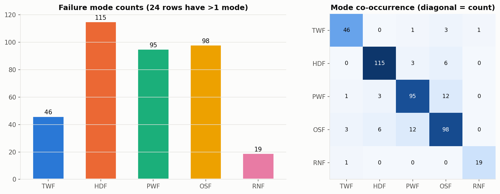

依 `Type` 比較故障率：

| Type | 筆數 | 故障率 |
|---|---|---|
| L | 6,000 | 3.92% |
| M | 2,997 | 2.77% |
| H | 1,003 | 2.09% |

### 3.3 標記不一致

有 9 筆 `machine_failure=1` 卻沒有任何模式標記，另有 18 筆 RNF=1 但
`machine_failure=0`。處理方式：主分析保留原始標記（machine_failure 即為實際紀錄的結果）；9 筆無模式的故障無法被規則解釋，18 筆 RNF 未計為故障屬資料產生過程的特性。另以 label_policy='drop_inconsistent' 移除這 27 筆做敏感度分析。

### 3.4 UDI 順序的時間結構

依 UDI 排序後，刀具磨耗有 98.8% 的相鄰列非遞減，並有 119 次換刀歸零；
空氣溫度的 lag-1 自相關為 0.9994。資料因此帶有時間結構，隨機切分會讓幾乎相同條件的相鄰列同時出現在訓練與測試，
所以本研究另做依時間順序切分的穩健性檢驗（第 5.2 節）。

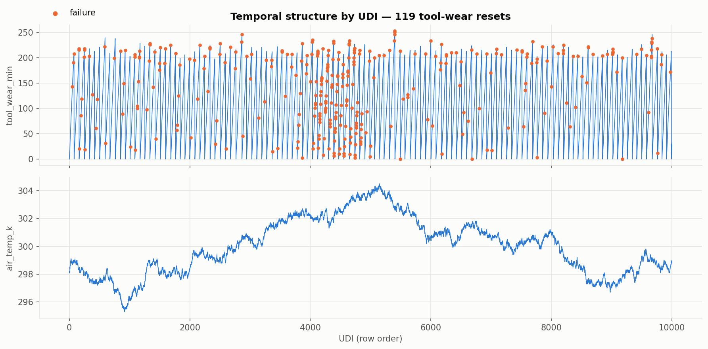

### 3.5 已知規則重建（研究問題 A 的標準答案）

依文獻規則（HDF：溫差 < 8.6 K 且轉速 < 1380 rpm；
PWF：功率 < 3500 W 或 > 9000 W；
OSF：磨耗 × 扭矩超過依 Type 而定的門檻；TWF：磨耗落在 200–240 min 視窗）
以原始特徵重算，與資料標記比對：

| 模式 | TP | FP | FN | Precision | Recall |
|---|---|---|---|---|---|
| HDF（散熱不良） | 115 | 0 | 0 | 1.000 | 1.000 |
| PWF（功率異常） | 95 | 0 | 0 | 1.000 | 1.000 |
| OSF（過度負荷） | 98 | 0 | 0 | 1.000 | 1.000 |
| TWF（刀具磨耗） | 43 | 747 | 3 | 0.054 | 0.935 |

HDF、PWF、OSF 三條規則與標記完全吻合（FP = FN = 0）。TWF 無法完全重建：依產生規則，每把刀在磨耗 200–240 min 之間的**隨機**時點失效，
視窗內的 790 列只有 43 列為 TWF（Precision 0.054）；
120 個刀具週期中有 116 個到達視窗，其中 46 個發生 TWF
（38.8%）。四條規則的聯集覆蓋 287 筆故障，漏掉 52 筆
（Recall 0.847），其中包含 9 筆沒有模式標記的故障。**因此純靠規則的偵測 Recall 上限約為 0.847；模型若要超過，只能靠 TWF 視窗內的機率排序，而這部分本質上是隨機的。**

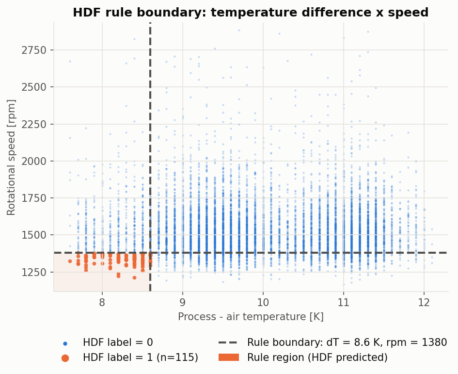

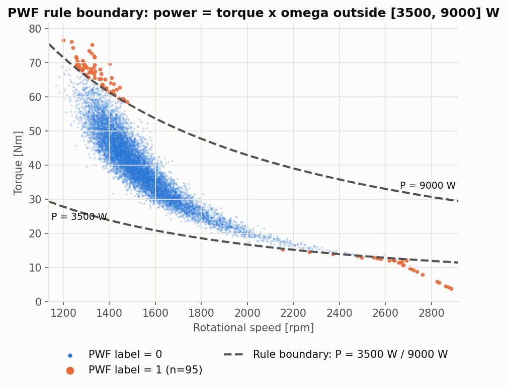

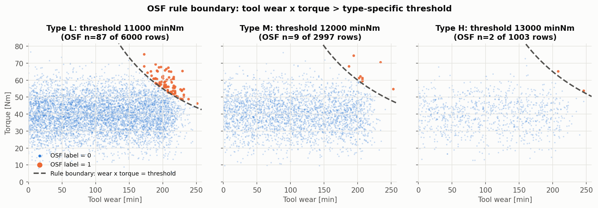

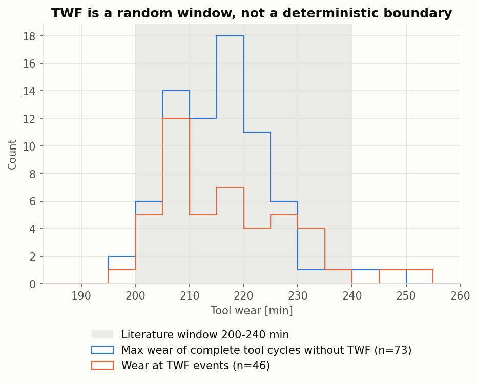

## 4. 方法

### 4.1 特徵組

- **原始特徵組**（8 欄）：空氣溫度、製程溫度、轉速、扭矩、刀具磨耗，加 `Type` 的 one-hot 三欄。
- **原始＋衍生特徵組**（11 欄）：再加三個依物理意義推導的特徵——溫差 = 製程溫度 − 空氣溫度（對應 HDF）、
  功率 = 扭矩 × 轉速 × 2π/60（對應 PWF）、過度負荷指標 = 刀具磨耗 × 扭矩（對應 OSF）。

兩組特徵都由 `build_features` 產生，程式內以斷言確保不含故障模式、目標與識別欄位。

### 4.2 切分與評估框架

- 以 UDI 為鍵做分層切分：訓練 6,000 ／驗證 2,000 ／測試 2,000 筆（60/20/20），切分結果存成 `splits.json` 供所有模組共用。
- 測試集不參與訓練、調參與門檻選擇，每個模型只在測試集評估一次。
- 開發集（訓練＋驗證，8,000 筆、272 筆故障）上做 5 折 × 2 次重複分層交叉驗證，
  報告平均值與 Nadeau–Bengio 校正的 95% 信賴區間；測試集指標的信賴區間以 1000 次 bootstrap 估計。
- 穩健性檢驗：依 UDI 時間順序切分（訓練／驗證／測試各取連續區段），與分層切分比較；兩種方案都先剔除共用測試集的列，避免測試集洩漏。
- 主要指標為 PR-AUC，輔以 Recall、Precision、F1 與 ROC-AUC。

### 4.3 模型、不平衡處理與門檻

- 模型：邏輯斯迴歸（基準）、隨機森林、HistGradientBoosting，以及主模型 MLP（early stopping，最多 300 次迭代）。
- 不平衡處理：不處理、類別權重、SMOTE 過採樣（過採樣包在 Pipeline 內，只作用於訓練折）。
  `MLPClassifier` 不支援 sample_weight，所以「類別權重」對 MLP 以隨機複製少數類實作。
- MLP 超參數網格：隱藏層 [[32], [64, 32], [128, 64]]、學習率 [0.001, 0.01]、L2 正則化 [0.0001, 0.001, 0.01]，
  只在驗證集上以 PR-AUC 評分。
- 每個 模型×特徵組 取 CV PR-AUC 最高的不平衡處理；最終模型只在訓練集訓練，驗證集用來選使 F1 最大的判斷門檻。

### 4.4 多標籤分類

對 TWF/HDF/PWF/OSF/RNF 各建一個獨立分類器（binary relevance，隨機森林），避免 classifier chain 把模式標籤回流成特徵。
RNF 是隨機產生的，理論上不可預測，因此用「與隨機基準比較」的方式檢驗：CV 的 ROC-AUC 信賴區間是否包含 0.5、
20 次標籤置換檢定（含保留時間區塊的版本，區塊大小 500）與固定標記比例下的偵測率。

### 4.5 可解釋性分析

- 排列重要度：8 個 模型×特徵組，以測試集 PR-AUC 的下降量衡量，重複 10 次。
- PDP／ICE：在規則座標（功率、溫差、磨耗×扭矩比、磨耗）上**介入原始感測欄位**再重算衍生特徵，
  畫出 ICE 曲線。判定「學到邊界」的標準：至少 80% 的 ICE 曲線在規則值 ±25% 內跨越模型門檻，且交點中位偏移不超過規則值的 10%。
- 決策邊界吻合度：測試集上模型預測與規則聯集的 Cohen kappa。
- 乘積規則實驗：以 MLP 預測「規則是否成立」（目標＝規則本身），比較原始與衍生特徵，並把訓練資料放大到 40,000 列（由規則合成），
  另以單一特徵軸平行的規則（轉速 < 1380）作為控制組。

### 4.6 成本模型

漏判成本 C_FN、誤報成本 C_FP = 1，成本比 C_FN:C_FP 取 1, 5, 10, 50, 100。
預期成本 = C_FN × FN + C_FP × FP。判斷門檻在驗證集上取使成本最低者，再原封不動套用到測試集；
並與「不預測」（成本 = C_FN × 故障數）與「全部檢修」（成本 = C_FP × 正常數）兩種基準策略比較。

## 5. 結果

### 5.1 PCA：線性降維看不出故障結構

| 特徵組 | 前 3 個主成分累計解釋變異 | 達 90% 所需主成分 | 僅前 3 個主成分的 CV ROC-AUC | 全部特徵的 CV ROC-AUC |
|---|---|---|---|---|
| 原始特徵 | 69.8% | 5 | 0.721 | 0.899 |
| 原始＋衍生特徵 | 64.6% | 5 | 0.777 | 0.926 |

前 3 個主成分在原始組解釋 69.8% 變異、衍生組 64.6%；
衍生特徵反而讓前 3 個主成分的占比下降，推測是乘積特徵帶進與原欄位不完全共線的新方向，使變異分散到更多主成分。
故障樣本多半落在正常樣本雲的邊緣，沒有形成獨立的群。原因是 PCA 不看標籤、只找變異最大的方向，而故障由非線性、局部的門檻規則產生；
單一主成分中最能分辨故障的是原始組的 PC6，並非變異最大的主成分。

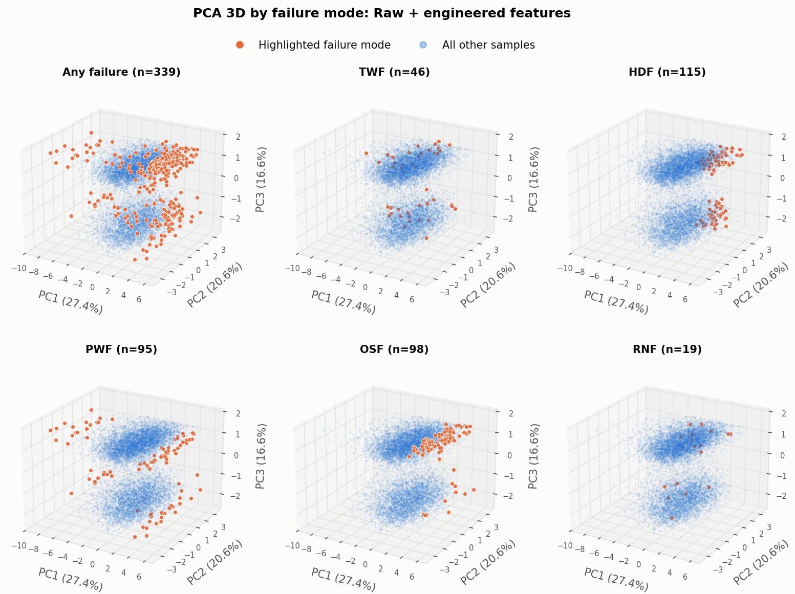

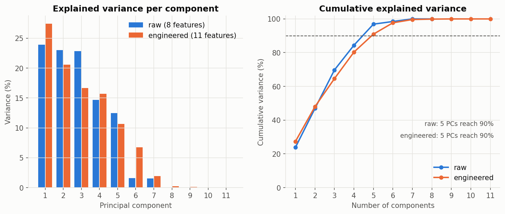

### 5.2 評估框架：切分方式影響結論

| 切分方式 | 訓練故障率 | 驗證故障率 | 測試故障率 |
|---|---|---|---|
| stratified | 3.40% | 3.40% | 3.35% |
| temporal | 4.25% | 2.25% | 1.95% |

時間順序切分下訓練／驗證／測試的故障率從 4.25% 降到 1.95%，
air_temp_k 的訓練對測試 KS 統計量高達 0.479（分層切分最大僅 0.019），分布明顯漂移。

| 切分方式 | 訓練→驗證 PR-AUC（平均） | 訓練→測試 PR-AUC（平均） |
|---|---|---|
| 分層（開發集內） | 0.670 | — |
| 依時間順序 | 0.569 | 0.508 |

在同樣的邏輯斯迴歸與隨機森林網格上，時間順序切分的平均 PR-AUC 從 0.670 降到
0.508，**分層切分高估了對「未來」資料的泛化能力**。後續主分析仍用分層切分（與資料的合成性質相符），
但所有結論都應附上這個保留。

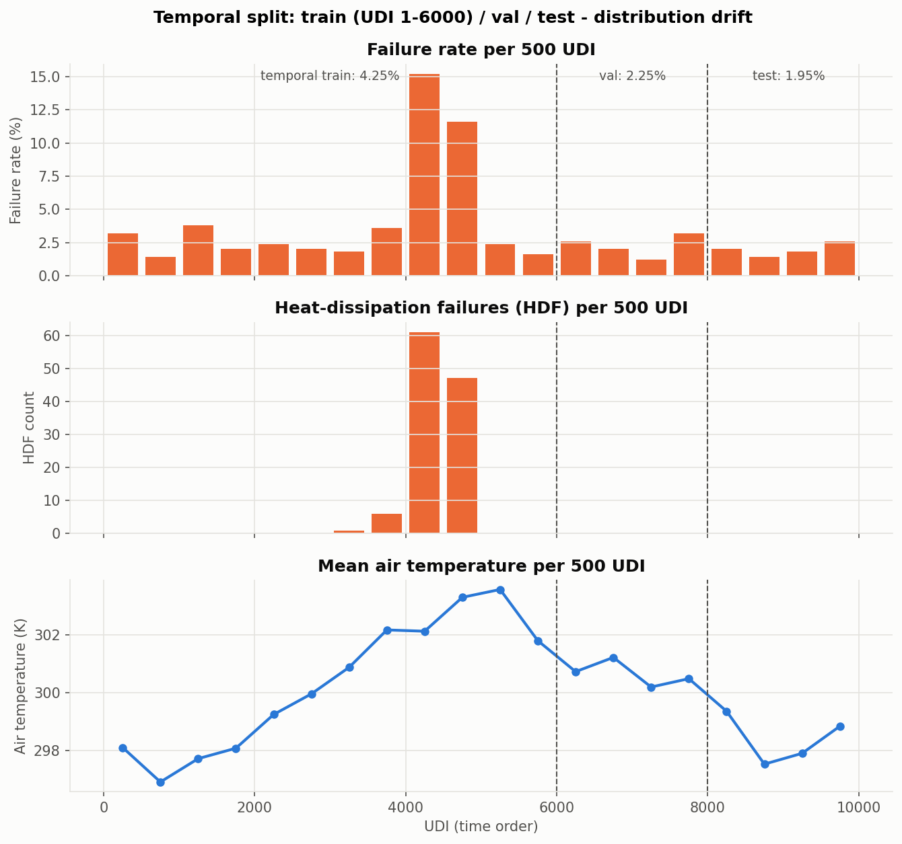

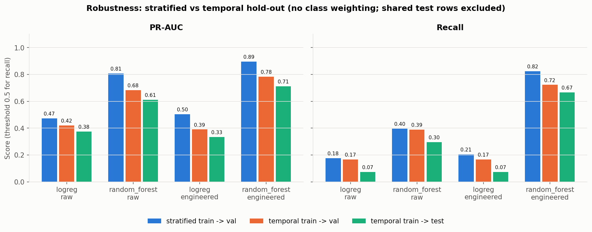

### 5.3 二元分類：模型 × 特徵組 × 不平衡處理

開發集重複 CV（各 模型×特徵組 取最佳不平衡處理；信賴區間為 Nadeau–Bengio 校正）：

| 模型 | 特徵組 | 不平衡處理 | PR-AUC [95% CI] | Recall | Precision | F1 | ROC-AUC |
|---|---|---|---|---|---|---|---|
| 邏輯斯迴歸 | 原始特徵 | none | 0.482 [0.381, 0.584] | 0.217 | 0.742 | 0.334 | 0.902 |
| 邏輯斯迴歸 | 原始＋衍生特徵 | none | 0.514 [0.419, 0.609] | 0.261 | 0.737 | 0.382 | 0.920 |
| 隨機森林 | 原始特徵 | none | 0.779 [0.720, 0.839] | 0.483 | 0.913 | 0.627 | 0.963 |
| 隨機森林 | 原始＋衍生特徵 | none | 0.900 [0.850, 0.951] | 0.814 | 0.974 | 0.886 | 0.977 |
| HistGradientBoosting | 原始特徵 | none | 0.809 [0.760, 0.858] | 0.678 | 0.879 | 0.764 | 0.970 |
| HistGradientBoosting | 原始＋衍生特徵 | none | 0.885 [0.842, 0.928] | 0.790 | 0.956 | 0.865 | 0.974 |
| MLP | 原始特徵 | class_weight | 0.693 [0.601, 0.786] | 0.787 | 0.419 | 0.544 | 0.954 |
| MLP | 原始＋衍生特徵 | class_weight | 0.743 [0.665, 0.821] | 0.805 | 0.464 | 0.585 | 0.960 |

6／8 個 模型×特徵組 的最佳不平衡處理是「不處理」：類別權重與 SMOTE 把 Recall 拉高，卻讓 Precision 大幅下降
（例如邏輯斯迴歸＋原始特徵：不處理 Precision 0.742，
類別權重 0.146）。MLP 的最佳處理為
class_weight（不處理時 PR-AUC 區間為 0.542 [0.283, 0.801]，極不穩定）。

測試集（2000 筆，67 筆故障；門檻取自驗證集；信賴區間為 bootstrap）：

| 模型 | 特徵組 | 門檻 | Recall | Precision | F1 | PR-AUC | ROC-AUC |
|---|---|---|---|---|---|---|---|
| 邏輯斯迴歸 | 原始特徵 | 0.298 | 0.239 [0.140, 0.343] | 0.444 [0.281, 0.613] | 0.311 [0.189, 0.417] | 0.316 [0.217, 0.429] | 0.874 [0.833, 0.913] |
| 邏輯斯迴歸 | 原始＋衍生特徵 | 0.248 | 0.299 [0.194, 0.412] | 0.417 [0.278, 0.563] | 0.348 [0.233, 0.456] | 0.377 [0.269, 0.496] | 0.897 [0.860, 0.930] |
| 隨機森林 | 原始特徵 | 0.365 | 0.597 [0.476, 0.708] | 0.800 [0.682, 0.904] | 0.684 [0.571, 0.775] | 0.808 [0.718, 0.885] | 0.979 [0.961, 0.992] |
| 隨機森林 | 原始＋衍生特徵 | 0.458 | 0.836 [0.743, 0.918] | 0.918 [0.842, 0.980] | 0.875 [0.807, 0.932] | 0.901 [0.835, 0.954] | 0.971 [0.935, 0.996] |
| HistGradientBoosting | 原始特徵 | 0.464 | 0.552 [0.426, 0.671] | 0.771 [0.642, 0.887] | 0.643 [0.529, 0.740] | 0.783 [0.689, 0.864] | 0.982 [0.970, 0.992] |
| HistGradientBoosting | 原始＋衍生特徵 | 0.584 | 0.776 [0.677, 0.867] | 0.981 [0.938, 1.000] | 0.867 [0.800, 0.922] | 0.892 [0.824, 0.948] | 0.977 [0.950, 0.996] |
| MLP | 原始特徵 | 0.949 | 0.522 [0.406, 0.645] | 0.686 [0.559, 0.813] | 0.593 [0.482, 0.694] | 0.636 [0.527, 0.735] | 0.959 [0.930, 0.979] |
| MLP | 原始＋衍生特徵 | 0.857 | 0.478 [0.352, 0.600] | 0.681 [0.553, 0.810] | 0.561 [0.442, 0.661] | 0.648 [0.543, 0.751] | 0.947 [0.911, 0.972] |

測試集的排序與 CV 一致：隨機森林＋原始＋衍生特徵最佳；MLP 的 PR-AUC 只有
0.636（原始）與 0.648（衍生），低於兩種樹模型。
MLP 訓練曲線上驗證損失最低的 epoch 為第 59（原始）與第 20（衍生）個。
各模型的機率校準以 ECE 衡量，隨機森林＋原始＋衍生特徵的 ECE 為
0.0030、Brier 0.0076。

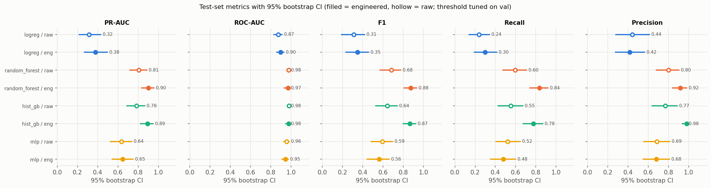

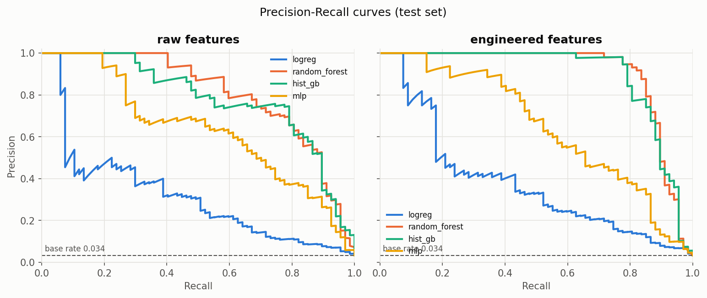

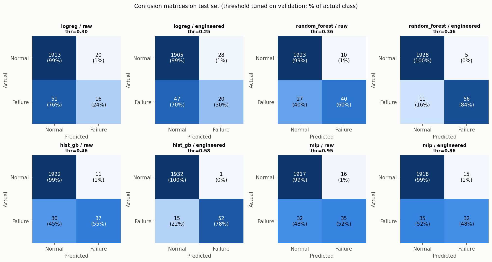

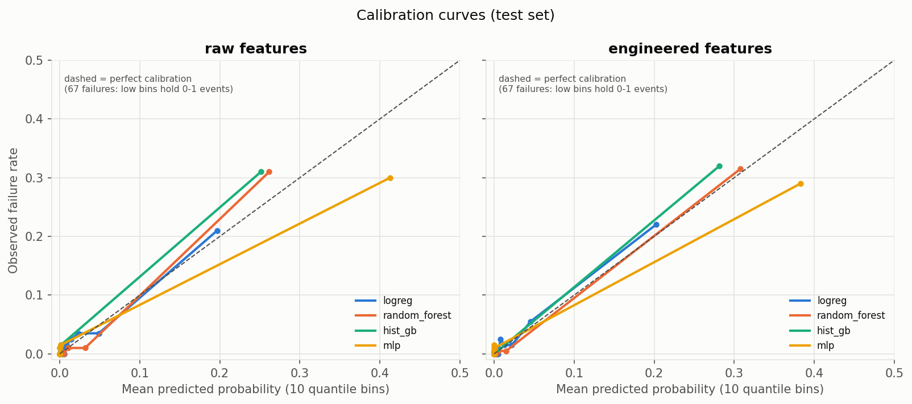

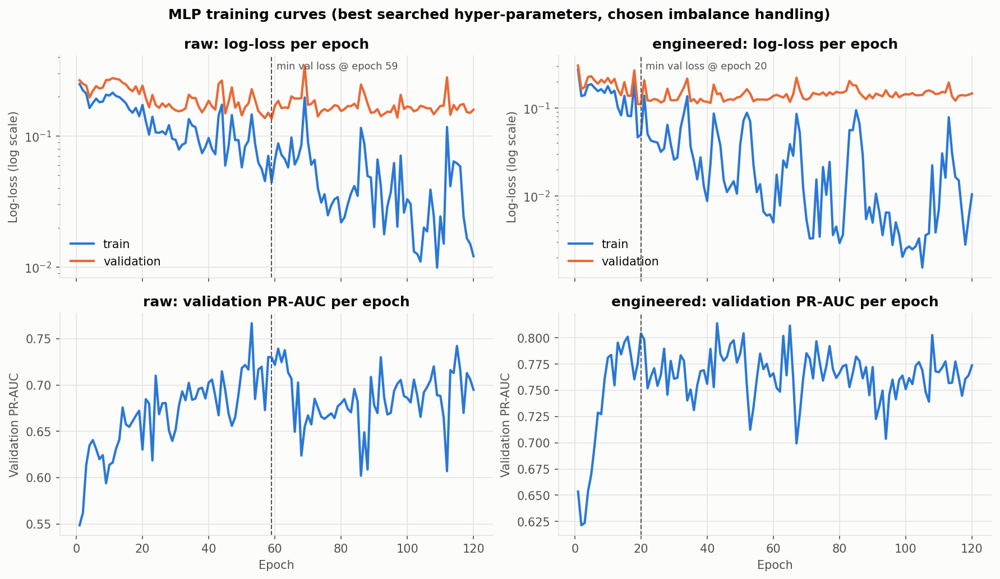

### 5.4 多標籤：哪一種故障

| 模式 | 測試集故障數 | Recall [95% CI] | Precision | F1 | ROC-AUC | PR-AUC |
|---|---|---|---|---|---|---|
| TWF（刀具磨耗） | 9 | 0.00 [0.00, 0.00] | 0.00 | 0.00 | 0.975 | 0.117 |
| HDF（散熱不良） | 22 | 0.91 [0.79, 1.00] | 0.91 | 0.91 | 1.000 | 0.984 |
| PWF（功率異常） | 18 | 1.00 [1.00, 1.00] | 0.95 | 0.97 | 1.000 | 1.000 |
| OSF（過度負荷） | 19 | 1.00 [1.00, 1.00] | 0.95 | 0.97 | 1.000 | 1.000 |
| RNF（隨機） | 5 | 0.00 [0.00, 0.00] | 0.00 | 0.00 | 0.401 | 0.003 |

HDF、PWF、OSF 三種有明確規則的模式 F1 皆 ≥ 0.91；
TWF 與 RNF 在 0.5 門檻下完全偵測不到。TWF 的 ROC-AUC 看似很高（0.975），
但這只代表模型能把「磨耗進入 200–240 min 視窗」的列排在前面，無法判斷視窗內哪一列會失效（見 3.5 節）。

**RNF 的實驗驗證。** RNF 實質上不可預測：0.5 門檻下 Recall=0、時間區塊 CV 置換檢定不顯著（ROC p=0.143）；一般分層 CV 的排序有微弱、邊緣的訊號（ROC p=0.095、PR p=0.048），可能與 RNF 在時間上的群聚（6/19 落在 200 個 UDI 內，掃描 p=0.0010）及溫度的時間代理效應有關。開發集 OOF 的 ROC-AUC 為 0.631，
CV 的 ROC-AUC 為 0.608 [0.423, 0.794]，
區間包含 0.5；
測試集 5 筆 RNF 偵測到 0 筆。整體判定「與隨機一致」：是。

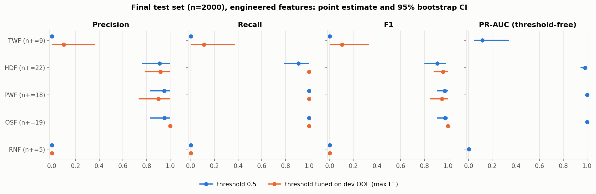

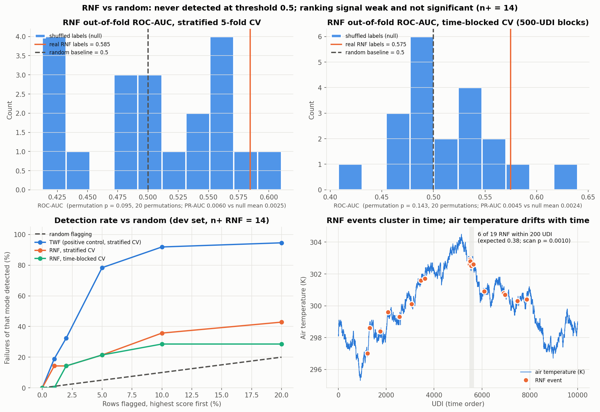

### 5.5 錯誤分析：漏判與誤報

主模型（隨機森林＋原始＋衍生特徵，門檻 0.458）在測試集得到
TP 56、FN 11、FP 5、TN 1928。逐筆對照規則邊界：

| 故障模式 | 測試集筆數 | 偵測到 | 偵測率 |
|---|---|---|---|
| TWF（刀具磨耗） | 9 | 0 | 0% |
| HDF（散熱不良） | 22 | 22 | 100% |
| PWF（功率異常） | 18 | 18 | 100% |
| OSF（過度負荷） | 19 | 19 | 100% |
| RNF（隨機） | 5 | 0 | 0% |

- 11 筆漏判中，9 筆是落在磨耗視窗的 TWF（隨機失效、規則本身無法判定），
  2 筆沒有任何規則能解釋（標記不一致的故障），規則成立卻被漏掉的有 0 筆。
- 5 筆誤報中，4 筆緊貼規則邊界的外側（相對距離 < 5%），1 筆落在 TWF 視窗內。
- 主模型對 HDF/PWF/OSF 的漏判數為 0/0/0，連貼近邊界 5% 以內的樣本也沒有漏掉；
  較弱的 MLP（原始特徵）則明顯依「規則成立的深度」而異：<=1% 的偵測率 0.25（n=16）、1-3% 的偵測率 0.62（n=16）、3-10% 的偵測率 0.88（n=16）、>10% 的偵測率 0.88（n=8），
  也就是它主要是漏掉剛好壓在邊界上的樣本。

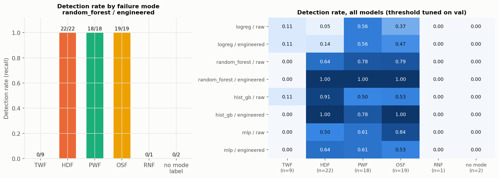

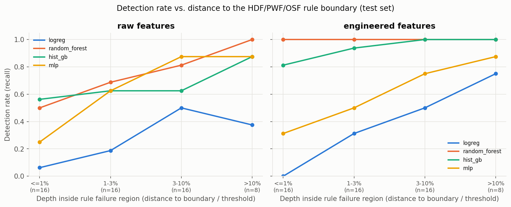

### 5.6 研究問題 A：模型的決策依據與規則是否一致？

**邊界吻合度。** 測試集上，模型預測與四條規則聯集的 Cohen kappa（越接近 1 越一致）：

| 模型 | kappa（原始） | kappa（衍生） | 測試 PR-AUC（原始） | 測試 PR-AUC（衍生） |
|---|---|---|---|---|
| 邏輯斯迴歸 | 0.31 | 0.35 | 0.316 | 0.377 |
| 隨機森林 | 0.75 | 0.96 | 0.808 | 0.901 |
| HistGradientBoosting | 0.68 | 0.95 | 0.783 | 0.892 |
| MLP | 0.64 | 0.61 | 0.636 | 0.648 |

**PDP/ICE 是否把門檻放在規則值上。** 在規則座標上介入後，各邊界被判為「學到」的模型數（共 4 個模型）：

| 邊界 | 原始特徵 | 衍生特徵 |
|---|---|---|
| P_low | 0/4 | 2/4 |
| P_high | 4/4 | 3/4 |
| dT | 0/4 | 2/4 |
| strain_ratio | 3/4 | 3/4 |

**排列重要度。** 隨機森林＋衍生特徵最重要的三個特徵為 rotational_speed_rpm, temp_diff_k, power_w（正是 HDF、PWF 規則所用的變數）；
MLP＋原始特徵為 torque_nm, air_temp_k, rotational_speed_rpm；隨機森林＋原始特徵為 torque_nm, air_temp_k, rotational_speed_rpm。

**分模式偵測率（測試集）。** 隨機森林＋衍生特徵：HDF 100%、PWF 100%、OSF 100%、
TWF 0%；MLP＋原始特徵：HDF 50%、PWF 61%、
OSF 84%、TWF 0%。

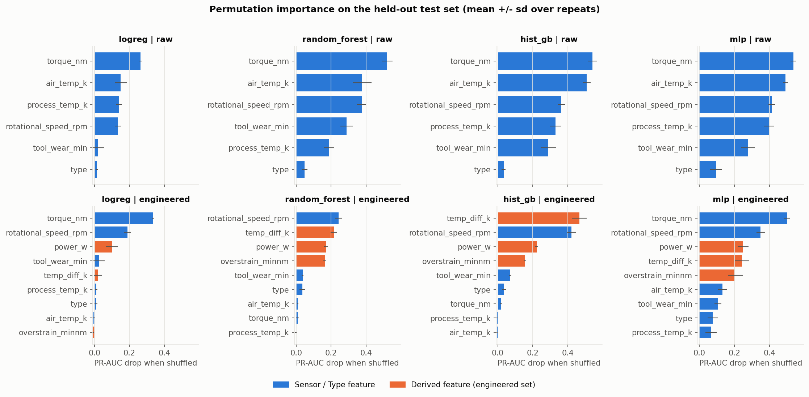

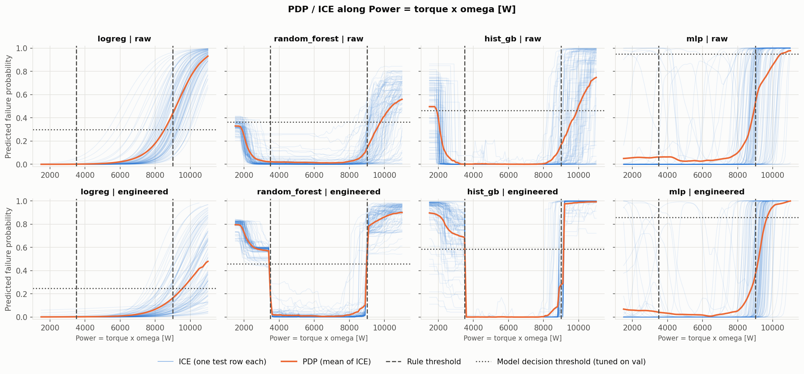

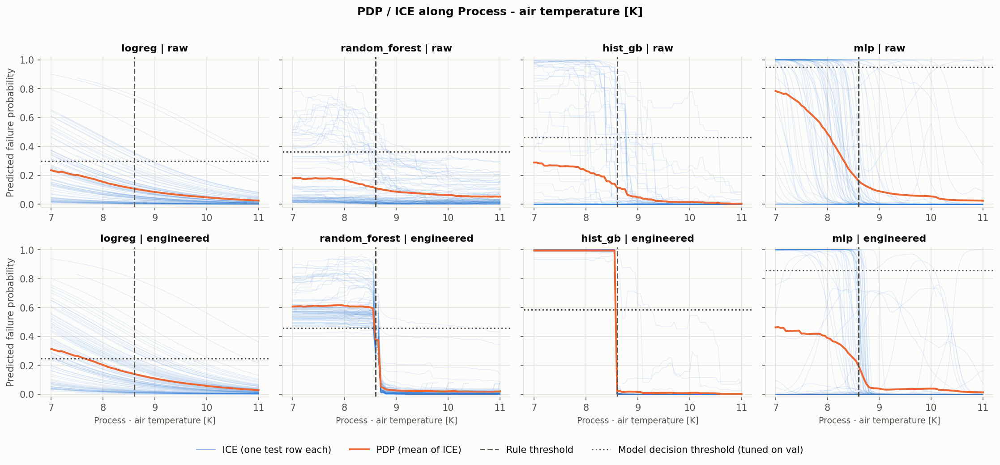

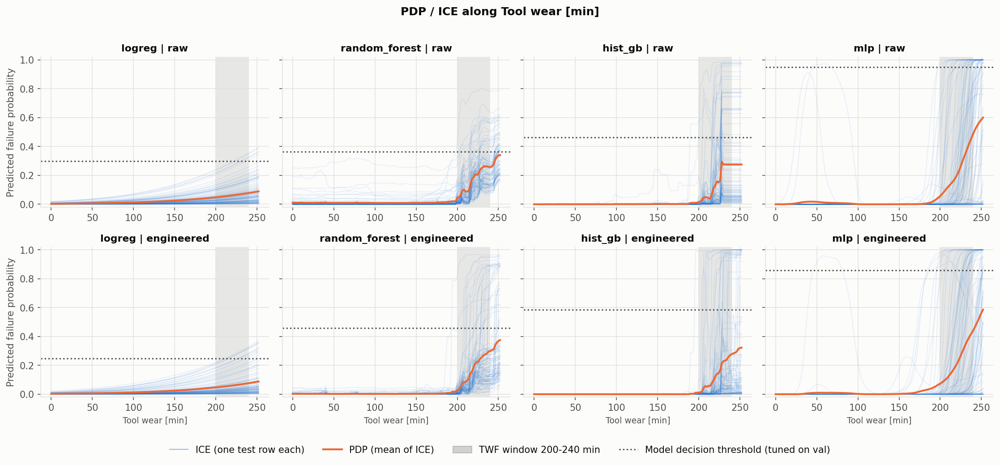

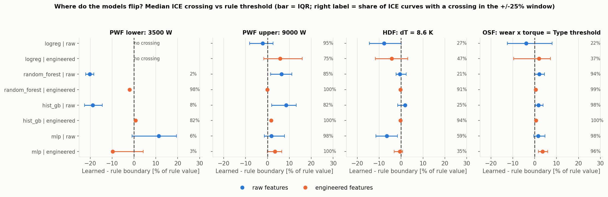

**回答 A**：**部分一致，且高度依賴模型與特徵組。** 吻合度最高的是隨機森林＋原始＋衍生特徵（kappa 0.96），
它對 HDF/PWF/OSF 的偵測率為 100%/100%/100%，
重要特徵正是規則變數。MLP 的 kappa 只有 0.64（原始）與 0.61（衍生）。
在 16 個「模型×邊界」組合中，原始特徵有 7 個、衍生特徵有 10 個達到「學到邊界」的標準；原始特徵下完全找不到的邊界是 P_low、dT
——這些多半是需要「兩個變數的組合」（功率、溫差）才能表達的邊界。TWF 的視窗只能學到「進入視窗後風險升高」，學不到視窗內的失效時點，與資料產生方式一致。

### 5.7 研究問題 B：衍生特徵的價值，MLP 能否自己學到乘積關係？

**B-1　衍生特徵的增益。** 開發集 CV 的 PR-AUC（各 模型 取其最佳不平衡處理；差值為 衍生 − 原始，Nadeau–Bengio 95% 區間）與測試集 PR-AUC：

| 模型 | CV 原始 | CV 衍生 | 差值 [95% CI] | 差值顯著？ | 測試 原始 | 測試 衍生 |
|---|---|---|---|---|---|---|
| 邏輯斯迴歸 | 0.482 | 0.514 | 0.031 [0.013, 0.050] | 是 | 0.316 | 0.377 |
| 隨機森林 | 0.779 | 0.900 | 0.121 [0.089, 0.153] | 是 | 0.808 | 0.901 |
| HistGradientBoosting | 0.809 | 0.885 | 0.076 [0.046, 0.106] | 是 | 0.783 | 0.892 |
| MLP | 0.693 | 0.743 | 0.050 [-0.002, 0.102] | 否 | 0.636 | 0.648 |

**B-2　MLP 能否學到乘積型規則？** 把預測目標換成「規則是否成立」（目標＝規則本身，無標記雜訊），比較原始與衍生特徵的 MLP 測試 PR-AUC
（真實 6,000 列訓練，3 個種子平均；以及由規則合成 40,000 列訓練）：

| 規則 | 真實 6,000 列 原始 | 真實 6,000 列 衍生 | 合成 40,000 列 原始 | 合成 40,000 列 衍生 | 合成 40,000 列 原始 F1 |
|---|---|---|---|---|---|
| OSF（磨耗×扭矩） | 0.958 | 0.961 | 0.997 | 0.995 | 0.97 |
| PWF（功率） | 0.922 | 0.785 | 0.978 | 0.988 | 0.92 |
| HDF（溫差且轉速） | 0.762 | 0.867 | 0.982 | 0.986 | 0.91 |

控制組（只涉及單一特徵軸的規則 轉速 < 1380）原始特徵即達 PR-AUC 0.998，顯示 MLP 的訓練流程本身沒有問題。

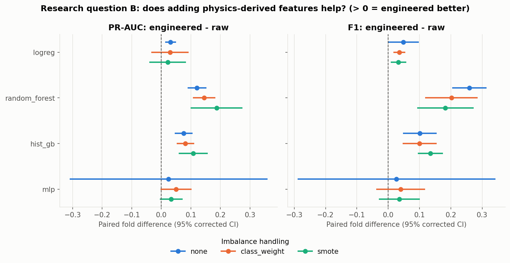

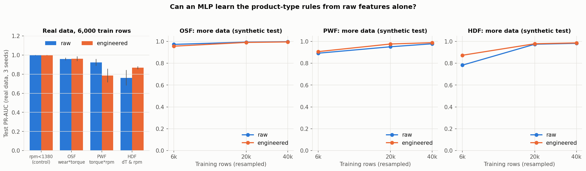

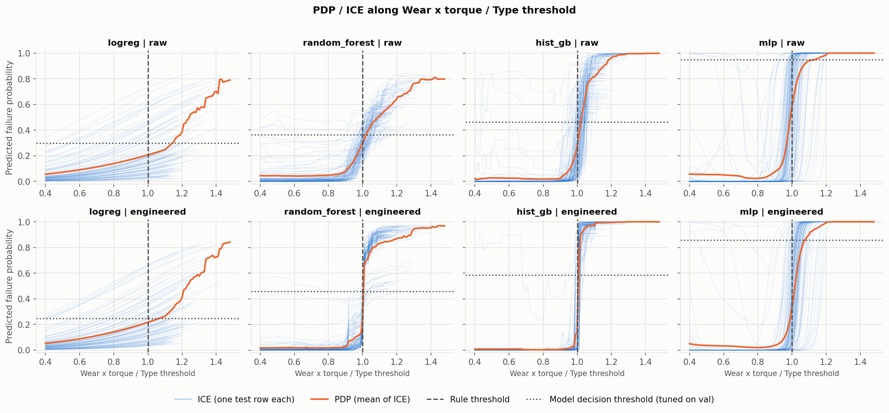

**回答 B**：**衍生特徵對樹模型的幫助大而顯著，對 MLP 不顯著；MLP 只靠原始特徵「能」學到乘積型規則，但不精準。**
(1) 隨機森林 CV PR-AUC 增加 0.121（95% 區間不含 0，顯著），HistGradientBoosting 增加 0.076（95% 區間不含 0，顯著），
MLP 增加 0.050（區間 [-0.002, 0.102]，95% 區間含 0，不顯著）。
(2) 「目標＝規則」時，MLP 在原始特徵上的 PR-AUC 為 OSF 0.958、PWF 0.922，
資料放大到 40,000 列後三條規則皆 ≥ 0.978，與衍生特徵相當，也就是它可以自行逼近乘積；
但 F1 只在 0.9 上下而非 1.0，邊界不精準。(3) 在含標記雜訊、開發集僅 272 筆故障的真實任務中，
MLP 測試 PR-AUC 為 0.636（原始）／0.648（衍生），遠低於隨機森林的 0.808／0.901。
換言之，**領域知識（衍生特徵）加樹模型，比期待神經網路自己發現乘積關係更有效率**。

### 5.8 研究問題 C：不同成本假設下的最佳門檻與預期成本

主模型為隨機森林＋原始＋衍生特徵。驗證集（2000 筆、68 筆故障）上找出使預期成本最低的門檻，
原封不動套用到測試集（2000 筆、67 筆故障）：

| C_FN:C_FP | 驗證集選出的門檻 | 測試 FN | 測試 FP | 測試成本 | 最佳基準策略與成本 | 節省比例 | 節省金額 95% CI | Recall | Precision |
|---|---|---|---|---|---|---|---|---|---|
| 1:1 | 0.458 | 11 | 5 | 16 | 不預測（全部不檢修） 67 | 76.1% | [36, 68] | 0.84 | 0.92 |
| 5:1 | 0.458 | 11 | 5 | 60 | 不預測（全部不檢修） 335 | 82.1% | [204, 361] | 0.84 | 0.92 |
| 10:1 | 0.224 | 10 | 11 | 111 | 不預測（全部不檢修） 670 | 83.4% | [420, 732] | 0.85 | 0.84 |
| 50:1 | 0.018 | 3 | 191 | 341 | 全部檢修 1933 | 82.4% | [1381, 1745] | 0.96 | 0.25 |
| 100:1 | 0.006 | 3 | 379 | 679 | 全部檢修 1933 | 64.9% | [844, 1558] | 0.96 | 0.14 |

「全部檢修」與「不預測」的成本在 C_FN:C_FP ≈ 28.9:1（= 正常數 / 故障數）處交叉；比例高於此值時，最佳基準由「不預測」變成「全部檢修」。
模型相對「不預測」的損益兩平比例約為 0.091:1；各模型的損益兩平比例（掃描範圍 0.01–200 的對數網格，0.010 代表落在網格下限）：
MLP／原始特徵 0.010；隨機森林／原始特徵 0.010；HistGradientBoosting／原始＋衍生特徵 0.021；隨機森林／原始＋衍生特徵 0.091；邏輯斯迴歸／原始＋衍生特徵 0.169；MLP／原始＋衍生特徵 0.212；HistGradientBoosting／原始特徵 0.252；邏輯斯迴歸／原始特徵 0.252。

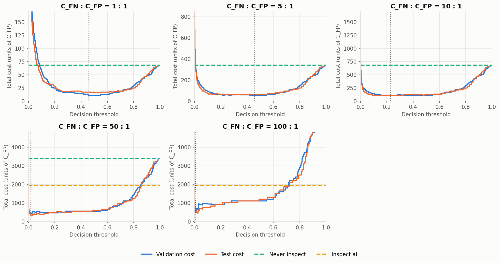

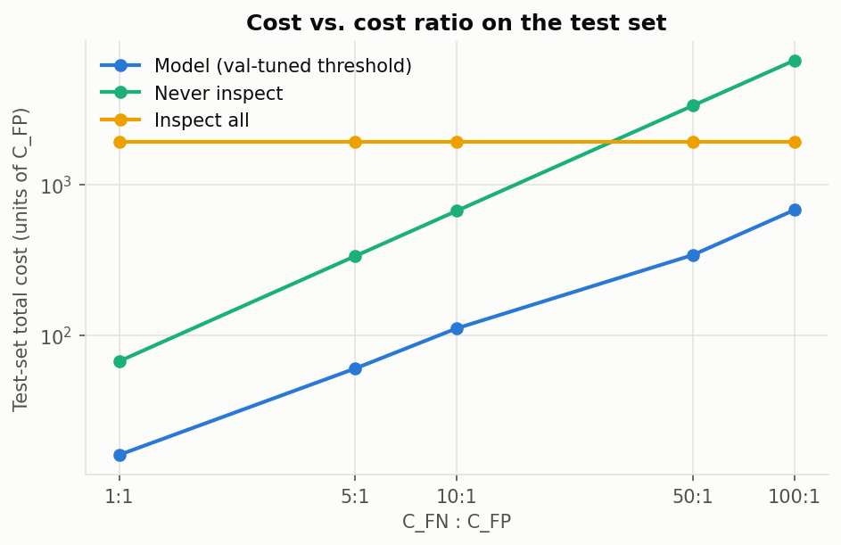

**回答 C**：**最佳門檻隨成本比例單調下降，從 0.458（1:1）降到 0.006（100:1）。**
測試集上，5:1 時模型成本 60（Recall 0.84、Precision 0.92），
相對最佳基準（不預測（全部不檢修），335）節省 82.1%（95% CI 節省 204–361 單位）；
100:1 時模型成本 679，基準為全部檢修 1933，節省 64.9%。
當漏判成本極高時，最佳門檻很低（0.006），模型願意送檢大量可疑機台（FP 379 筆），換取只漏 3 筆故障。
**需要誠實說明的是**：因為模型排序品質高，只檢修最有把握的少數機台就能在任何 C_FN > 0 下略有獲利，損益兩平比例（0.091:1）
遠低於實務上合理的成本比，所以「值得部署」的真正門檻不在成本比例，而在節省金額是否大於模型部署與維運成本。

## 6. 討論

### 6.1 主要發現的意義

1. **規則已知的資料上，「準」不等於「學到規則」。** 隨機森林＋衍生特徵的測試 PR-AUC 達 0.901，
   但 MLP 的 kappa 只有 0.64／0.61；用規則邊界檢查，才看得出哪些模型只是在逼近而非掌握規則。
2. **領域知識是便宜且有效的歸納偏誤。** 三個衍生特徵就讓隨機森林的 CV PR-AUC 增加 0.121，
   而 MLP 在大量資料或乾淨目標下才勉強追上，與 Grinsztajn et al.（2022）對樹模型在表格資料上的觀察方向一致。
3. **模型的錯誤大多可以被資料的產生過程解釋。** 測試集 11 筆漏判中 9 筆是隨機失效的 TWF，
   2 筆是標記不一致；這些錯誤不是調參能解決的上限。
4. **成本決策應該用成本，而不是 F1。** 最佳門檻從 0.458 降到 0.006，
   用單一固定門檻（例如 0.5）無法同時適應不同的維護成本結構。

### 6.2 研究限制

- **資料是合成的。** 規則由人設定、噪音來源有限（RNF 與標記不一致），結果不能直接外推到真實產線；樹模型的優勢可能被「規則是門檻型」放大。
- **只判斷故障當下的狀態。** 特徵與故障同時量測，沒有時間窗，因此不是預測未來故障；成本分析中的「檢修」是指對當下狀態做處置。
- **測試集故障數少。** 測試集僅 67 筆故障，單次測試指標的 95% 信賴區間很寬（例如主模型 Recall 0.836 [0.743, 0.918]），
  模型之間小的差距（例如 HistGradientBoosting 與隨機森林）不應過度解讀。
- **時間結構與分布漂移。** 時間順序切分的平均 PR-AUC 從 0.670 降到 0.508（只比較邏輯斯迴歸與隨機森林），
  分層切分的結果可能高估泛化；時間切分的驗證段與測試段的 HDF 筆數分別為 0 與 0，也限制了可下的結論。
- **TWF 不可完全重建、RNF 不可預測。** 規則聯集的 Recall 上限為 0.847；
  RNF 的檢定樣本很少（開發集 14 筆，置換次數僅 20），p 值解析度有限，結論是「與隨機一致」而非「證明不可預測」。
- **MLP 的搜尋範圍有限。** 網格僅 18 組、且受 2 顆 CPU 的計算預算限制；
  「類別權重」以隨機複製少數類實作。更大的網路、更久的訓練或特徵標準化之外的處理，可能縮小與樹模型的差距。
- **解釋方法的假設。** PDP/ICE 以介入單一欄位再重算衍生特徵的方式進行，會產生資料中不存在的組合；「學到邊界」的判準（80% 的曲線、±25% 視窗、10% 偏移）是人為設定，換用其他閾值結論的細節可能改變。
- **成本模型是簡化的。** 假設每個漏判與誤報的成本固定且與機台無關；損益兩平比例 0.091:1 很低，代表在此假設下模型幾乎總是「值得」，真實決策還要計入部署與維運成本。
- **標記不一致列的處理。** 主分析保留原始標記；剔除不一致列只在規則重建中做了敏感度分析，未對全部模型重做。

## 7. 結論

本研究以 AI4I 2020 的已知規則為標準答案，得到三個以數據支持的結論：

- **A（可解釋性）**：模型與規則的一致程度因模型與特徵而異。最一致的是隨機森林＋原始＋衍生特徵（kappa 0.96）；
  MLP 僅 0.64／0.61。16 個模型×邊界組合中，原始特徵 7 個、衍生特徵 10 個學到規則邊界。
- **B（領域知識）**：衍生特徵使隨機森林 CV PR-AUC 增加 0.121（顯著），對 MLP 不顯著；
  MLP 在乾淨目標下可以只靠原始特徵近似乘積規則，但邊界不精準，在真實含雜訊任務上測試 PR-AUC 僅 0.636，低於樹模型。
- **C（維護決策）**：最佳門檻隨成本比例從 0.458 降到 0.006；
  5:1 時節省 82.1%、100:1 時節省 64.9%（相對最佳基準策略）。

實務上的建議是：先用物理知識建立衍生特徵、用樹模型取得強基準，再用規則邊界檢查模型是否為了對的理由而準，最後以成本而非 F1 決定門檻。
所有數字與圖表皆由 `python -m ai4i_lab.pipeline` 自動重新產生。

## 參考文獻

1. Matzka, S. (2020). Explainable Artificial Intelligence for Predictive Maintenance Applications. *2020 Third International Conference on Artificial Intelligence for Industries (AI4I)*, 69–74.
2. Chawla, N. V., Bowyer, K. W., Hall, L. O., & Kegelmeyer, W. P. (2002). SMOTE: Synthetic Minority Over-sampling Technique. *Journal of Artificial Intelligence Research*, 16, 321–357.
3. Saito, T., & Rehmsmeier, M. (2015). The Precision-Recall Plot Is More Informative than the ROC Plot When Evaluating Binary Classifiers on Imbalanced Datasets. *PLOS ONE*, 10(3), e0118432.
4. Nadeau, C., & Bengio, Y. (2003). Inference for the Generalization Error. *Machine Learning*, 52, 239–281.
5. Breiman, L. (2001). Random Forests. *Machine Learning*, 45, 5–32.
6. Friedman, J. H. (2001). Greedy Function Approximation: A Gradient Boosting Machine. *Annals of Statistics*, 29(5), 1189–1232.
7. Goldstein, A., Kapelner, A., Bleich, J., & Pitkin, E. (2015). Peeking Inside the Black Box: Visualizing Statistical Learning with Plots of Individual Conditional Expectation. *Journal of Computational and Graphical Statistics*, 24(1), 44–65.
8. Grinsztajn, L., Oyallon, E., & Varoquaux, G. (2022). Why Do Tree-Based Models Still Outperform Deep Learning on Typical Tabular Data? *NeurIPS 2022 Datasets and Benchmarks Track*.
9. Elkan, C. (2001). The Foundations of Cost-Sensitive Learning. *Proceedings of the 17th International Joint Conference on Artificial Intelligence (IJCAI)*, 973–978.
10. Guo, C., Pleiss, G., Sun, Y., & Weinberger, K. Q. (2017). On Calibration of Modern Neural Networks. *ICML 2017*.
11. Pedregosa, F., et al. (2011). Scikit-learn: Machine Learning in Python. *Journal of Machine Learning Research*, 12, 2825–2830.
12. UCI Machine Learning Repository. AI4I 2020 Predictive Maintenance Dataset (id 601). https://archive.ics.uci.edu/dataset/601/ai4i+2020+predictive+maintenance+dataset
