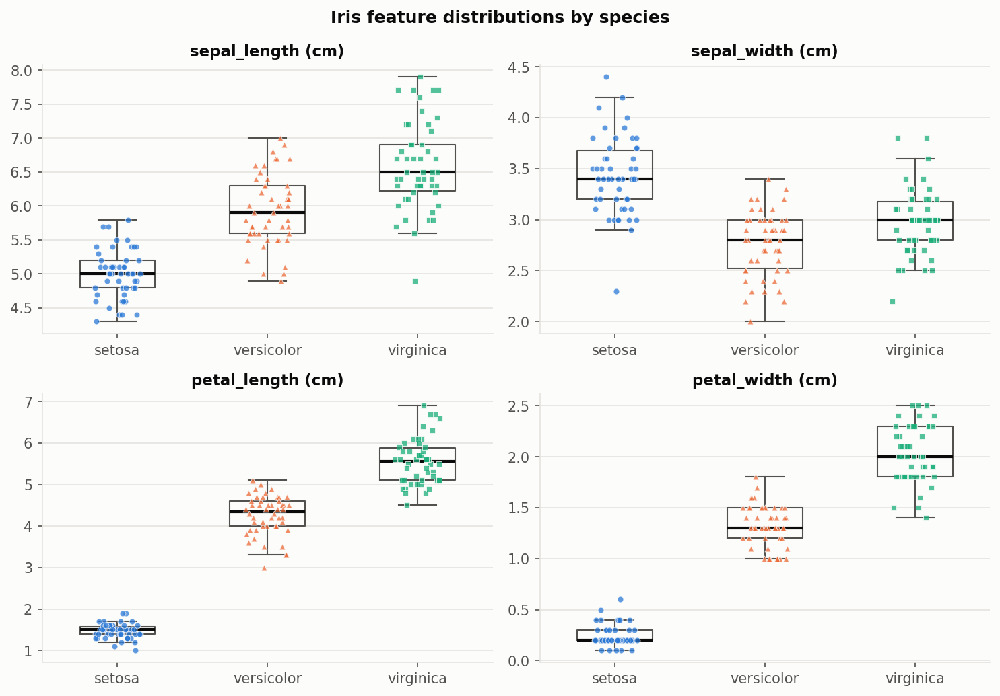
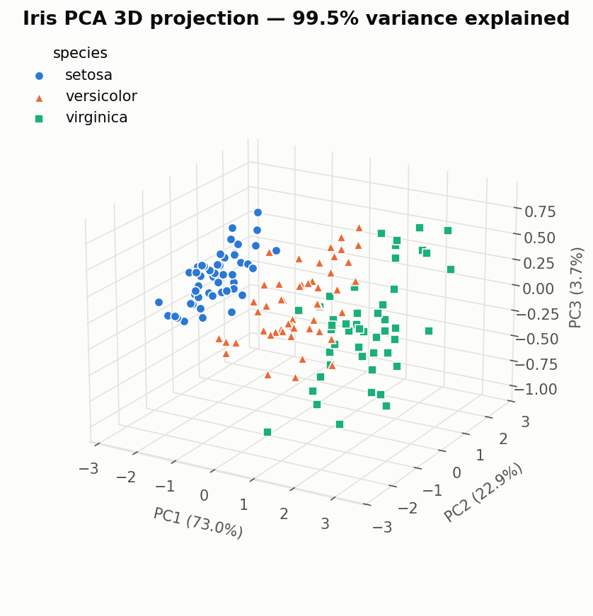
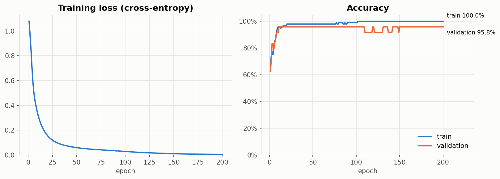
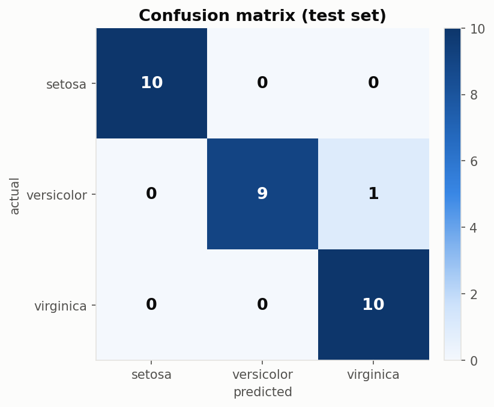

# 以多層感知器類神經網路進行鳶尾花（Iris）分類之研究

## 摘要

本研究使用經典的 Iris 資料集（150 筆、4 個特徵、3 個類別），先進行資料探索與主成分分析（PCA），
再以多層感知器（Multilayer Perceptron, MLP）類神經網路建立分類模型。PCA 結果顯示前三個主成分可解釋
99.48% 的總變異，其中 setosa 與其他兩類可明顯分離。模型以分層抽樣切分 120 筆訓練、
30 筆測試資料，於測試集上達到 **96.67%** 的準確率與 0.967 的 macro F1；
5 折交叉驗證平均準確率為 96.00%（標準差 5.48%，各折介於 90%–100%），與測試集結果一致。

## 1. 前言

Iris 資料集由 Fisher（1936）提出，是機器學習與統計分類最常用的入門資料集之一。
其特徵維度低、類別平衡，適合用來完整練習「資料取得 → 探索 → 降維視覺化 → 建模 → 評估」的流程。
本研究的目標為：（1）了解資料欄位與特徵分布；（2）以 PCA 觀察資料在低維空間的結構；
（3）以類神經網路建立分類器並評估其效果。

## 2. 資料與探索

### 2.1 資料來源與欄位

資料取自 scikit-learn 內建之 Iris 資料集（源自 UCI Machine Learning Repository），保存於 `data/iris.csv`。
共 150 筆樣本，包含 4 個數值特徵（單位：公分）與 1 個類別欄位 `species`。

| 欄位 | 說明 | 平均 | 標準差 | 最小 | 最大 |
|---|---|---|---|---|---|
| `sepal_length` | 花萼長度 | 5.843 | 0.828 | 4.3 | 7.9 |
| `sepal_width` | 花萼寬度 | 3.057 | 0.436 | 2.0 | 4.4 |
| `petal_length` | 花瓣長度 | 3.758 | 1.765 | 1.0 | 6.9 |
| `petal_width` | 花瓣寬度 | 1.199 | 0.762 | 0.1 | 2.5 |

分類目標 `species` 共三類：**setosa**（山鳶尾）、**versicolor**（變色鳶尾）、**virginica**（維吉尼亞鳶尾），
各 50 筆，類別完全平衡。

### 2.2 資料檢查

- 缺失值：0 個
- 重複列：1 筆（屬於原始資料中的真實觀測，予以保留）
- 類別分布：setosa 50 筆, versicolor 50 筆, virginica 50 筆

各類別特徵平均值如下：

| 類別 | sepal_length | sepal_width | petal_length | petal_width |
|---|---|---|---|---|
| setosa | 5.006 | 3.428 | 1.462 | 0.246 |
| versicolor | 5.936 | 2.770 | 4.260 | 1.326 |
| virginica | 6.588 | 2.974 | 5.552 | 2.026 |

可以看出花瓣（petal）特徵在三類之間差異最大，且 petal_length 與 petal_width 的相關係數高達 0.963。
setosa 的花瓣明顯較小，而 versicolor 與 virginica 的數值範圍有部分重疊。

*圖 1：各特徵依類別之分布（箱形圖＋散點）*

### 2.3 主成分分析（PCA）

由於四個特徵尺度不同，先以 z-score 標準化後再進行 PCA。三個主成分的解釋變異比例分別為
PC1 72.96%、PC2 22.85%、PC3 3.67%，累積 99.48%。
圖 2 顯示 setosa 在 PC1 方向上與其他兩類完全分離，versicolor 與 virginica 則在邊界處略有交疊，
預期分類錯誤主要會出現在這兩類之間。

*圖 2：Iris 資料前三個主成分之 3D 分布*

## 3. 研究方法

### 3.1 資料切分

以分層抽樣（stratified sampling）將資料依 8:2 切分為訓練集 120 筆與測試集 30 筆，
確保每類比例一致；並再從訓練集中切出 20%（約 24 筆）作為驗證集，用於觀察學習曲線。
測試集完全不參與訓練與調整，僅用於最終評估。隨機種子固定為 42 以確保可重現。

### 3.2 模型架構

| 項目 | 設定 |
|---|---|
| 前處理 | StandardScaler（僅以訓練資料擬合） |
| 網路結構 | 4 → 16 → 8 → 3 |
| 隱藏層激活函數 | RELU |
| 輸出層 | Softmax |
| 損失函數 | Cross-entropy |
| 最佳化器 | Adam（學習率 0.01） |
| Batch size | 16 |
| 訓練回合數 | 200 epochs |

### 3.3 評估指標

以測試集上的準確率（accuracy）、各類別 precision / recall / F1 與混淆矩陣評估模型；
另以 5 折分層交叉驗證評估模型表現的穩定度。

## 4. 實驗結果

### 4.1 訓練過程

訓練損失由 1.078 下降至 0.005；最終訓練準確率 100.00%、
驗證準確率 95.83%，兩者差距 4.2%，未見明顯過擬合。

*圖 3：訓練損失與訓練／驗證準確率曲線*

### 4.2 測試集評估

測試集準確率 **96.67%**，macro F1 = **0.967**。

| 類別 | Precision | Recall | F1 | 樣本數 |
|---|---|---|---|---|
| setosa | 1.000 | 1.000 | 1.000 | 10 |
| versicolor | 1.000 | 0.900 | 0.947 | 10 |
| virginica | 0.909 | 1.000 | 0.952 | 10 |

*圖 4：測試集混淆矩陣*

### 4.3 交叉驗證

5 折交叉驗證準確率：100.00%, 100.00%, 90.00%, 100.00%, 90.00%；平均 96.00%，標準差 5.48%。

## 5. 討論

測試集 30 筆中共有 1 筆誤判（versicolor 被誤判為 virginica 共 1 筆）。誤判皆發生在 versicolor 與 virginica 之間。整體結果與 PCA 觀察到的資料結構一致：setosa 在特徵空間中與其他類別線性可分，
而 versicolor 與 virginica 的花瓣尺寸有部分重疊，是本問題中唯一真正困難的部分。

本研究的限制包括：（1）資料量僅 150 筆，測試集只有 30 筆，單一筆誤判即影響約
3.3% 的準確率，因此另以交叉驗證輔助判斷；（2）Iris 為簡單且乾淨的資料集，
結果不一定能推廣到雜訊較多的真實資料；（3）未進行系統性的超參數搜尋。
未來可嘗試比較其他模型（如邏輯斯迴歸、SVM）或進行超參數調整。

## 6. 結論

本研究完成了 Iris 資料的取得、探索、PCA 3D 視覺化，並以兩層隱藏層的 MLP 類神經網路建立分類器。
模型在測試集上達到 96.67% 準確率，交叉驗證平均 96.00%，
顯示即使是小型類神經網路，在經過適當標準化與資料切分後，也能有效完成 Iris 分類任務。

## 參考文獻

1. Fisher, R. A. (1936). The use of multiple measurements in taxonomic problems. *Annals of Eugenics*, 7(2), 179–188.
2. Dua, D., & Graff, C. (2019). *UCI Machine Learning Repository*. University of California, Irvine.
3. Pedregosa, F., et al. (2011). Scikit-learn: Machine Learning in Python. *Journal of Machine Learning Research*, 12, 2825–2830.
4. Pearson, K. (1901). On lines and planes of closest fit to systems of points in space. *Philosophical Magazine*, 2(11), 559–572.
